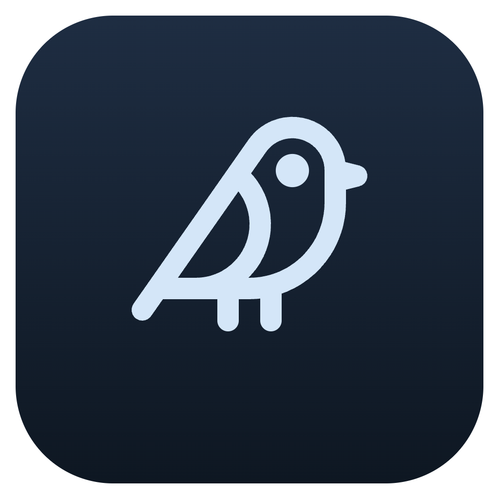
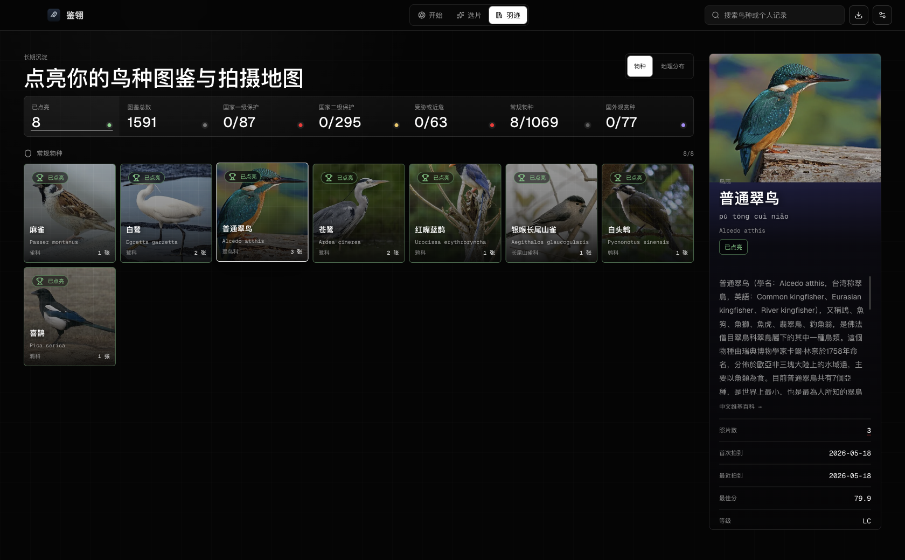

<p align="center">
  
</p>

<h1 align="center">PlumeLens / 鉴翎</h1>

<p align="center">
  面向鸟类摄影爱好者的本地选片工具，提供鸟类检测、画质评估、鸟种识别与人工复核。
</p>

<p align="center">
  <a href="https://github.com/wlfcss/PlumeLens/actions/workflows/ci.yml"></a>
  <a href="https://github.com/wlfcss/PlumeLens/actions/workflows/mac-build.yml"></a>
  
  
  <a href="https://github.com/wlfcss/PlumeLens/actions/workflows/windows-build.yml"></a>
  
  
  <a href="LICENSE"></a>
</p>


## 下载安装

发行版均随附本地分析所需的完整模型。请前往 [GitHub Releases](https://github.com/wlfcss/PlumeLens/releases) 按平台下载对应安装包与 `.sha256` 校验文件并置于同一目录：

| 平台                       | 获取方式                                                                 | 安装说明                                        |
| -------------------------- | ------------------------------------------------------------------------ | ----------------------------------------------- |
| macOS 14+ · Apple 芯片     | [0.7.9 Release](https://github.com/wlfcss/PlumeLens/releases/tag/v0.7.9)（`PlumeLens-0.7.9-arm64.dmg` + `.sha256`） | 打开镜像，将 `PlumeLens.app` 拖入「应用程序」。 |
| Windows x64                | [0.7.9 Release](https://github.com/wlfcss/PlumeLens/releases/tag/v0.7.9)（`PlumeLens-0.7.9-Windows-x64.zip` + `.sha256`） | 完整解压到独立文件夹，双击 `PlumeLens.exe`。    |

macOS 可在下载目录执行 `shasum -a 256 -c PlumeLens-0.7.9-arm64.dmg.sha256`。Windows 的校验命令和 AMD 加速设置见 [Windows 指南](WINDOWS.md)。

> **系统与升级兼容说明**：`0.7.9` 起 macOS 最低系统要求为 **macOS 14.0（Sonoma）+**（macOS 13 用户请继续使用 [0.7.8](https://github.com/wlfcss/PlumeLens/releases/tag/v0.7.8)）。从 `0.7.x` 原地升级会完整保留已有 SQLite 图库、历史分析结果、人工评级、人工物种修正与加密配置；升级后对老文件夹执行「开始分析」默认跳过已有有效分析结果的照片，仅分析新增或变更原片，且旧版 CoreML 编译缓存会在新引擎就绪后自动清理。

## 主要功能

| 功能       | 说明                                                             |
| ---------- | ---------------------------------------------------------------- |
| 照片筛选   | 按精选、可用、记录、淘汰分档，结合鸟种、飞版和关键词筛选         |
| 深度复核   | 查看检测框、姿态、画质裁切和 EXIF，人工调整评级与鸟种            |
| 分组浏览   | 按场景组织照片，支持连拍堆叠、组视图和平铺视图                   |
| 照片导出   | 按当前筛选或自定档位导出，支持照片格式选择、XMP 元数据与中文清单 |
| 羽迹图鉴   | 汇总鸟种记录，查看保护等级、物种资料与拍摄地点                   |
| 文件夹管理 | 保存工作记录，支持源目录移动后的重新关联                         |
| 诊断日志   | 本地运行日志自主开关，记录硬件与任务耗时并支持一键导出脱敏日志包 |

分析在本机完成，不修改源照片；人工评级与鸟种修正优先于模型结果。

## 界面预览

| 开始                                        | 选片                                            | 羽迹                                          |
| ------------------------------------------- | ----------------------------------------------- | --------------------------------------------- |
|  |  |  |

截图来自使用随附授权图片构建的演示图库，鸟种与评级已人工确认。图片作者及许可见[第三方图片归因](resources/species-artwork/THIRD_PARTY_ATTRIBUTIONS.md)。

## 0.7.9 更新

- 升级桌面运行时至 Electron 45.4.1（macOS 最低基线 14.0+）及全量 Python/JS 依赖（Pillow 13、LibRaw 0.22.2、ONNX Runtime 1.32、PyTorch 2.14.1、Transformers 5.24、ECharts 6.1 等，OSV 零已知漏洞）。
- 新增隐私优先的客户端日志与诊断模块（首次启动知情同意、四分栏设置「日志与诊断」、单向 HMAC 设备标识、硬件画像、任务耗时与一键导出脱敏 ZIP 诊断包）。
- Apple Silicon 推理管线切换至 CoreML `MLProgram` + 版本隔离持久化缓存，结合 48 层 LoRA 权重融合、多鸟批推理、RAW 纯 NumPy 原地转正（峰值内存降 50%+）、SQLite Schema v14 与 4 连接只读池，常规鸟图吞吐提升 65%–75%，二次冷启缩短 66%。
- 新增深度复核 A/B 并排对照、Lightroom 导出预设与大库分页/紧凑摘要流，叠加 `manualChunks` 拆包使首屏主入口体积降至 756 kB；完成全栈安全/并发/架构审计五波次加固与 CI/测试体系重构，升级原地保留历史记录并默认跳过已分析照片。

[0.7.9 发布说明](docs/releases/0.7.9.md) · [完整更新日志](CHANGELOG.md) · [GitHub Release](https://github.com/wlfcss/PlumeLens/releases/tag/v0.7.9)

| 历史版本 | 主要更新                                              |
| -------- | ----------------------------------------------------- |
| 0.7.8    | Windows x64 便携包、AMD 原生加速、RAW 预览与资源自适应 |
| 0.7.7    | 鸟种多选与筛选导出、人工复核及任务恢复                |
| 0.7.6    | 后台导出、格式选择、工作集文件夹移除                  |
| 0.7.5    | 前端结构整理、离线鸟种封面、安全与测试完善            |
| 0.7.0    | DINOv3 species v4、姿态与飞版分析、复核及羽迹功能更新 |

## 分析与分级


| 阶段       | 模型                                       | 输出                                  |
| ---------- | ------------------------------------------ | ------------------------------------- |
| 鸟类检测   | YOLOv26l-bird-det v1.1                     | 鸟类位置与检测框                      |
| 姿态与飞版 | bird_visibility v2.0、flight classifier v1 | 11 个关键点、部位可见性与飞行状态     |
| 画质评估   | CLIPIQA+、HyperIQA                         | 语义画质与技术画质评分                |
| 鸟种识别   | DINOv3 species v4                          | 1591 类鸟种，区分已识别、待审和未识别 |

基础画质分由 `0.40 × CLIPIQA+ + 0.60 × HyperIQA` 计算，系统档位再按姿态可见性与飞行状态调整。人工评级可覆盖系统档位。

| 档位 | 基础分数           |
| ---- | ------------------ |
| 精选 | ≥ 0.75             |
| 可用 | 0.60 ≤ 分数 < 0.75 |
| 记录 | 0.45 ≤ 分数 < 0.60 |
| 淘汰 | < 0.45             |

待审判断可用于选片筛选；羽迹统计仅接收符合档位要求、物种归属可信的照片。模型规格、校准策略与许可见[模型说明](engine/models/README.md)。

## 技术架构与数据


桌面端使用 Electron 45、React 19 和 TypeScript；后端使用 Python、FastAPI 与 SQLite WAL。检测、姿态、飞版和画质模型由 ONNX Runtime 执行，鸟种识别由 PyTorch 与 transformers 执行。

- 照片分析无需上传原片；地图查询和版本检查可能联网。
- 数据库、缩略图、任务记录及可选的本地运行日志均保存在应用数据目录；日志默认征得用户同意后开启，照片文件名经单向哈希匿名处理，绝不自动上传，可随时在「设置 → 日志与诊断」中开关或导出脱敏诊断包。
- 导出写入单独选择的目标目录，不修改源照片。
- 桌面端通过本地鉴权接口访问后端，缩略图使用受限的本地协议加载。

## 开发与构建

开发环境使用 Node.js 24、Python 3.11+ 和 [uv](https://docs.astral.sh/uv/)。macOS CI 使用 Python 3.11，Windows CI 使用 Python 3.12；提供 macOS arm64 DMG 与 Windows x64 便携包。

```bash
git clone https://github.com/wlfcss/PlumeLens.git
cd PlumeLens
npm ci
uv sync --extra dev
npm start
```

完整分析需要模型资产；未入 Git 的大文件须单独恢复，详见[模型说明](engine/models/README.md)。

首次运行 Web E2E 前，执行 `npx playwright install chromium` 安装测试浏览器。

常用检查：

```bash
npm run typecheck
npm run lint
npm test
npm run build
npm run test:e2e
uv run ruff check .
uv run pyright --pythonpath .venv/bin/python
uv run pytest -m "not integration"
```

macOS 打包：

```bash
npm run dist:mac
```

Windows AMD 开发与打包（PowerShell）：

```powershell
powershell -ExecutionPolicy Bypass -File scripts/setup-windows-amd.ps1
$env:PLUMELENS_PYTHON = "$pwd\.venv-amd\Scripts\python.exe"
npm run dist:win
```

Windows 发行包解压后运行 `PlumeLens.exe`；首次启用原生 AMD 检测可先运行随包的 `prepare-windows-gpu.cmd`。应用会根据 CPU、内存和可用 GPU 后端设置并发，并在内存紧张时减少新任务。AMD 依赖版本、设备目标与手动覆盖见 [Windows 指南](WINDOWS.md)。

产物位于 `release/`。PR 与主分支由 [CI 质量检查](.github/workflows/ci.yml) 在 Linux 上统一执行静态检查、前后端单元测试、生产构建与 Web Playwright E2E；主分支与手动操作分别触发 [macOS 构建](.github/workflows/mac-build.yml) 与 [Windows 构建](.github/workflows/windows-build.yml) 完成模型 SHA-256 校验、后端冻结、打包与实包冒烟验证；版本标签由 [协同发布工作流](.github/workflows/release.yml) 待双端构建与验收均通过后统一发布至 GitHub Release。

## 许可证

代码采用 [GPL-3.0](LICENSE)。模型权重、分类数据和鸟类图片按各自来源许可使用，详见[模型说明](engine/models/README.md)与[图片归因](resources/species-artwork/THIRD_PARTY_ATTRIBUTIONS.md)。
