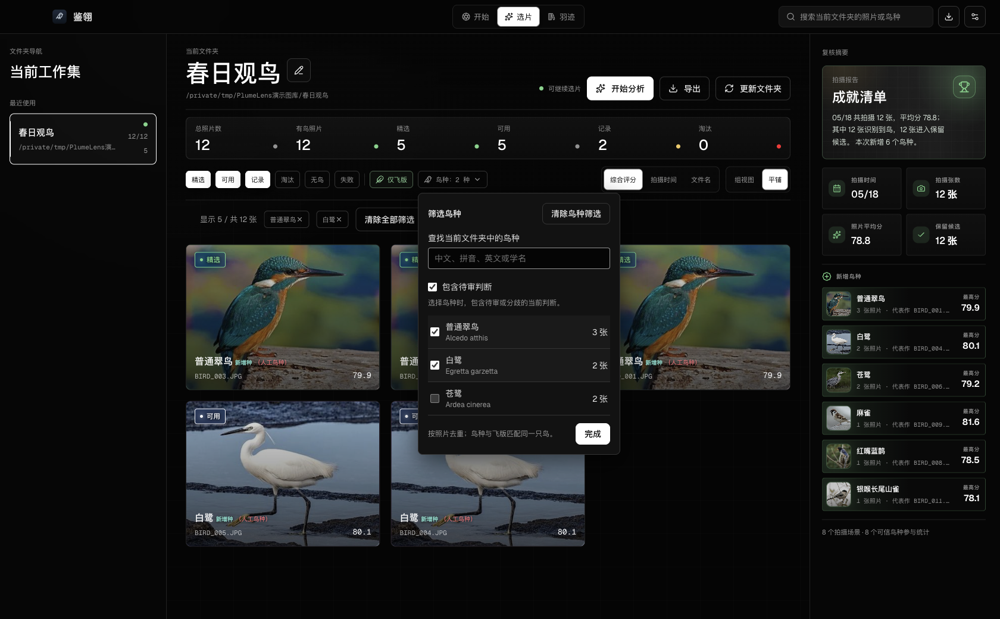
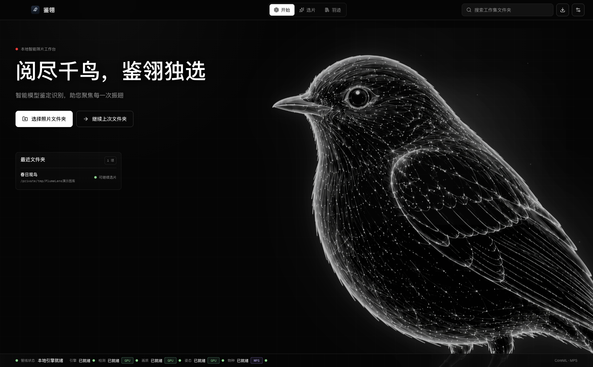
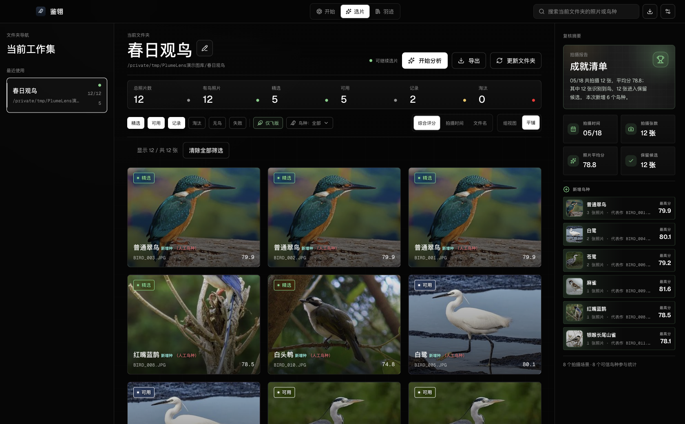
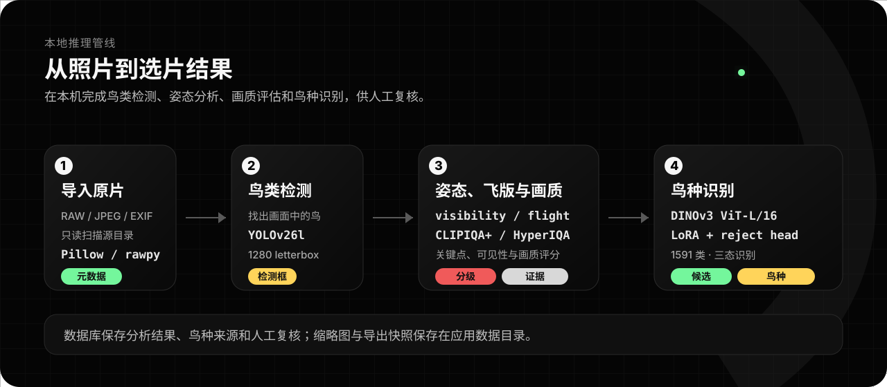
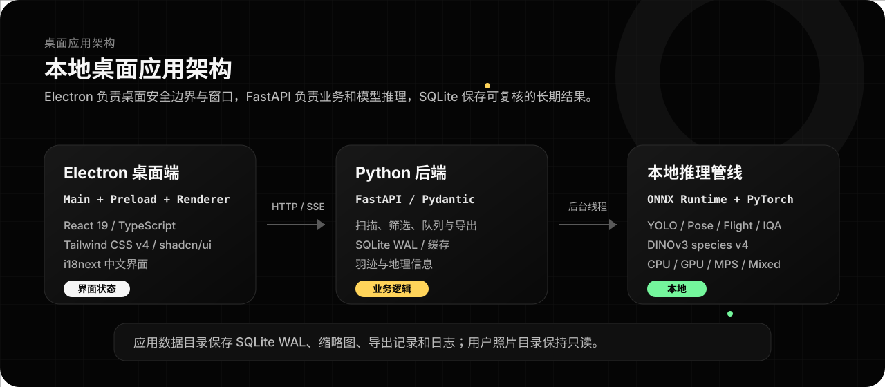

<p align="center">
  
</p>

<h1 align="center">PlumeLens / 鉴翎</h1>

<p align="center">
  面向鸟类摄影爱好者的本地选片工具，提供鸟类检测、画质评估、鸟种识别与人工复核。
</p>

<p align="center">
  <a href="https://github.com/wlfcss/PlumeLens/actions/workflows/mac-build.yml"></a>
  
  
  
  <a href="LICENSE"></a>
</p>



## 主要功能

| 功能       | 说明                                                             |
| ---------- | ---------------------------------------------------------------- |
| 照片筛选   | 按精选、可用、记录、淘汰分档，结合鸟种、飞版和关键词筛选         |
| 深度复核   | 查看检测框、姿态、画质裁切和 EXIF，人工调整评级与鸟种            |
| 分组浏览   | 按场景组织照片，支持连拍堆叠、组视图和平铺视图                   |
| 照片导出   | 按当前筛选或自定档位导出，支持照片格式选择、XMP 元数据与中文清单 |
| 羽迹图鉴   | 汇总鸟种记录，查看保护等级、物种资料与拍摄地点                   |
| 文件夹管理 | 保存工作记录，支持源目录移动后的重新关联                         |

分析在本机完成，不修改源照片；人工评级与鸟种修正优先于模型结果。

## 界面预览

| 开始                                        | 选片                                            | 羽迹                                          |
| ------------------------------------------- | ----------------------------------------------- | --------------------------------------------- |
|  |  |  |

截图来自使用随附授权图片构建的演示图库，鸟种与评级已人工确认。图片作者及许可见[第三方图片归因](resources/species-artwork/THIRD_PARTY_ATTRIBUTIONS.md)。

## 0.7.7 更新

- 新增可搜索的鸟种多选，支持待审与未识别鸟；组合飞版条件时匹配同一只鸟。
- 当前筛选可直接导出，启动任务时固定照片范围；文件校验后再生成最终文件。
- 修复换图后的旧结果复用、并发事务、重复任务及暂停、取消后的重试问题。
- 改善保存反馈、键盘操作、弹窗焦点、缩略图恢复和应用关闭流程。

本版更新了缓存与 RAW 方向处理规则，重新分析后生效；人工评级保留。完整变更见 [CHANGELOG](CHANGELOG.md)。

| 历史版本 | 主要更新                                              |
| -------- | ----------------------------------------------------- |
| 0.7.6    | 后台导出、格式选择、工作集文件夹移除                  |
| 0.7.5    | 前端结构整理、离线鸟种封面、安全与测试完善            |
| 0.7.0    | DINOv3 species v4、姿态与飞版分析、复核及羽迹功能更新 |

## 分析与分级



| 阶段       | 模型                                       | 输出                                  |
| ---------- | ------------------------------------------ | ------------------------------------- |
| 鸟类检测   | YOLOv26l-bird-det v1.1                     | 鸟类位置与检测框                      |
| 姿态与飞版 | bird_visibility v2.0、flight classifier v1 | 11 个关键点、部位可见性与飞行状态     |
| 画质评估   | CLIPIQA+、HyperIQA                         | 语义画质与技术画质评分                |
| 鸟种识别   | DINOv3 species v4                          | 1591 类鸟种，区分已识别、待审和未识别 |

基础画质分由 `0.40 × CLIPIQA+ + 0.60 × HyperIQA` 计算，系统档位再按姿态可见性与飞行状态调整。人工评级可覆盖系统档位。

| 档位 | 基础分数           |
| ---- | ------------------ |
| 精选 | ≥ 0.75             |
| 可用 | 0.60 ≤ 分数 < 0.75 |
| 记录 | 0.45 ≤ 分数 < 0.60 |
| 淘汰 | < 0.45             |

待审判断可用于选片筛选；羽迹统计仅接收符合档位要求、物种归属可信的照片。模型规格、校准策略与许可见[模型说明](engine/models/README.md)。

## 技术架构与数据



桌面端使用 Electron 41、React 19 和 TypeScript；后端使用 Python、FastAPI 与 SQLite WAL。检测、姿态、飞版和画质模型由 ONNX Runtime 执行，鸟种识别由 PyTorch 与 transformers 执行。

- 照片分析无需上传原片；地图查询和版本检查可能联网。
- 数据库、日志、缩略图及任务记录保存在应用数据目录。
- 导出写入单独选择的目标目录，不修改源照片。
- 桌面端通过本地鉴权接口访问后端，缩略图使用受限的本地协议加载。

## 开发与构建

开发环境使用 Node.js 24、Python 3.11+ 和 [uv](https://docs.astral.sh/uv/)。当前打包平台为 macOS arm64。

```bash
git clone https://github.com/wlfcss/PlumeLens.git
cd PlumeLens
npm ci
uv sync --extra dev
npm start
```

完整分析需要模型资产；未入 Git 的大文件须单独恢复，详见[模型说明](engine/models/README.md)。

首次运行 Web E2E 前，执行 `npx playwright install chromium` 安装测试浏览器。

常用检查：

```bash
npm run typecheck
npm run lint
npm test
npm run test:e2e
uv run ruff check .
uv run pyright --pythonpath .venv/bin/python
uv run pytest
```

macOS 打包：

```bash
npm run dist:mac
```

产物位于 `release/`。PR 执行质量检查，主分支和版本标签触发 macOS 构建；模型包来源与发布配置见[构建工作流](.github/workflows/mac-build.yml)。

## 许可证

代码采用 [GPL-3.0](LICENSE)。模型权重、分类数据和鸟类图片按各自来源许可使用，详见[模型说明](engine/models/README.md)与[图片归因](resources/species-artwork/THIRD_PARTY_ATTRIBUTIONS.md)。
